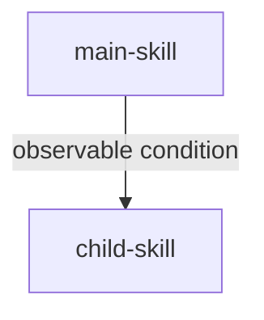

# {{合并技能标题}}

> 模板版本：9.0.0。合并判定必须来自全局检查；pair 兼容不足以标记成功。替换所有 `{{字段}}` 并填写真实计数。

## Section 1：适用范围与排除场景

- **适用任务**：`{{可观察任务范围}}`
- **排除场景**：`{{不适用任务与条件}}`
- **来源技能**：`{{规范化名称列表}}`
- **全局判定依据**：`{{pair + 三元/N 元 + 对抗复核摘要}}`

## Section 2：保留规则与决策规则

### 2.1 必须同时满足的规则

| 输出规则 | 源规则 ID | 规范要求 |
|---|---|---|
| `{{输出规则 ID}}` | `{{来源 ID}}` | `{{合并后的规范句}}` |

### 2.2 条件与顺序

| 优先级 | 可观察条件 | 决策/顺序 | 排除场景 | 来源 ID |
|---|---|---|---|---|
| 1 | `{{条件}}` | `{{先/后/分区/条件覆盖}}` | `{{排除}}` | `{{ID}}` |

S0 安全规则在所有分支同时有效。S3 风格张力使用明确双模式，不得熔断。

## Section 3：Fallback 主/子技能拆分

触发任一条件时评估：估算 Token>4000、规则>50、额外顺序约束>3、任务域可独立判定。

| 子技能 | 加载条件 | 排除条件 | 分配规则 ID | 触发词互斥声明 |
|---|---|---|---|---|
| `{{子技能名}}` | `{{可观察条件}}` | `{{互斥范围}}` | `{{唯一归属 ID}}` | `{{与其他子技能不重叠的声明}}` |



```json
{
  "nodes": ["main-skill", "child-skill"],
  "edges": [
    {"from": "main-skill", "to": "child-skill", "relation": "load", "condition": "observable condition", "directed": true}
  ]
}
```

拆分不删除规则。未拆分也应保留本节并写“未达到拆分门槛；无子技能”，同时删除上述占位图或将其替换为实际单节点图。

## Section 4：全局 worked example

### 输入

```text
{{最小但完整的用户请求与必要上下文}}
```

### 输出/执行安排

```text
{{步骤或句子 1：映射保留规则 ID}}
{{步骤或句子 2：映射保留规则 ID}}
{{步骤或句子 3：映射保留规则 ID}}
```

### 4.1 覆盖检查

| 示例行/句 | 覆盖的保留规则 ID | 证据 |
|---|---|---|
| `{{1}}` | `{{ID}}` | `{{如何满足}}` |

反向核对：`{{每条必要保留规则到示例行/句的完整映射}}`。

### 4.2 负向检查

- 保留规则违反项：`{{逐项检查；无则写“无”}}`。
- 未声明例外：`{{无或具体项}}`。
- 干扰覆盖的冗余步骤：`{{无或具体项}}`。

### 4.3 最小性检查

| 删除项 | 失去的规则覆盖 | 是否可删 |
|---|---|---|
| `{{步骤/句子}}` | `{{规则 ID}}` | 否 |

若无法通过三检查，回退重构最多两次并记录每次问题、改动 ID 和结果；仍失败则不得标“合并成功”。

## Section 5：Provenance 处置表

| 输出规则/章节 | 源规则 ID | 处置 | 理由 |
|---|---|---|---|
| `{{输出位置}}` | `{{ID}}` | `{{keep/deduplicate/conditional-override/move-to-subskill/route/defer-human/exclude-with-reason}}` | `{{证据与平局理由}}` |

所有源规则必须且只能出现于一个最终处置类别。

## Section 6：未纳入规则及理由

| 源规则 ID | 去向/未纳入原因 | 用户授权 | 复核方式 |
|---|---|---|---|
| `{{ID；无则写“无”}}` | `{{deduplicate/exclude-with-reason 等理由}}` | `{{不适用/已授权/待授权}}` | `{{验证方法}}` |

## Section 7：迁移指南

1. 将旧技能触发入口替换为 `{{新技能或 Router 入口}}`。
2. 按 `{{条件}}` 加载对应子技能，不同时加载互斥版本。
3. 用 `{{测试用例 ID}}` 重跑 pair、三元/N 元和 worked example 三检查。
4. 将接管探针状态保留为 `not-run`，直到真实执行并记录模型、版本、输入与结果。

## 摘要

```yaml
arbiter-summary:
  version: "9.0.0"
  mode: "full"
  skills_in: 0
  groups_out: 1
  verdict: "human-review"
  rules: {total: 0, kept: 0, deduped: 0, conditional: 0, deferred: 0, excluded: 0}
  conflicts: {exclusive: 0, shared: 0, entangled: 0, contradictory: 0, dependency: 0, intent: 0}
  severity: {S0: 0, S1: 0, S2: 0, S3: 0}
  degraded_level: "none"
  actionability: "prompt-generated"
  confidence: {certain: 0, high: 0, medium: 0, low: 0}
  open_questions: ["模板尚未填充", "接管探针: not-run"]
  appeal_path: "无强不一致判定；提供新证据后重新运行全局检查"
```

<!-- FILE END: templates/merged-skill.md -->
<!-- PROGRESS: 5/21 -->
