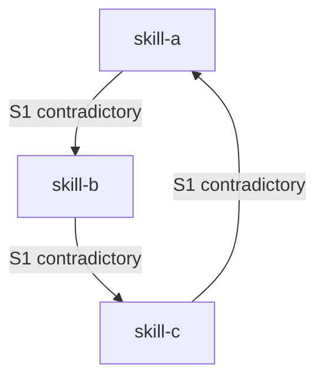

# Skill Arbiter 拒绝报告

> 模板版本：9.0.0。将 `{{字段}}` 替换为当前输入的真实结果；不得保留无数据结论或虚构计数。

## 1. 结论与范围

- ** verdict **：`rejected`
- **熔断模式**：`{{full/circuit-breaker 等允许值}}`
- **输入技能**：`{{规范化技能名列表}}`
- **受影响组合**：`{{冲突团或组合}}`
- **不受影响独立组**：`{{独立组列表；无则写“无”}}`
- **降级与证据损失**：`{{none/L1/L2/L3 及损失}}`
- **团检测声明**：近似检测，不保证找到全部极大团；极大团不等于最大团。

## 2. 全局不一致表

| 组合/边 | 严重度 | 置信度 | 规则 ID | 双方逐字原文与位置 | 为何无同时满足解释 | 对抗复核失败原因 |
|---|---|---|---|---|---|---|
| `{{A ↔ B}}` | `{{S0/S1}}` | `{{high/certain}}` | `{{A:Rn; B:Rm}}` | A：“{{原文}}”（{{章节/行号}}）；B：“{{原文}}”（{{章节/行号}}） | `{{对齐任务、范围、对象后的无解论证}}` | `{{被违反的具体规则 ID 与原因}}` |

不得只凭关键词、相似度、同名工具或 L3 指纹填表。文本截断或置信度低于 `high` 时不得形成确定性强拒绝。

## 3. 子集安全说明

- 拒绝该组合不代表所有子集均不安全：`{{哪些 pair/独立组仍可分析}}`。
- pair 兼容不代表 N 元兼容；本结论基于：`{{三元/N 元检查范围}}`。
- 未检查组合：`{{列表；无则写“无”}}`。
- 对不受影响子集只允许输出 `{{partial-merge/human-review 等}}`，不得隐去本报告中的强冲突。

## 4. 冲突图

三元环文字图：

```text
{{skill-a}} --[{{S1 contradictory; A:R1 ↔ B:R1}}]--> {{skill-b}}
{{skill-b}} --[{{S1 contradictory; B:R2 ↔ C:R1}}]--> {{skill-c}}
{{skill-c}} --[{{S1 contradictory; C:R2 ↔ A:R2}}]--> {{skill-a}}
```

以下为结构占位示例；真实报告须替换节点、边和证据，并保持两图一致。



```json
{
  "nodes": ["skill-a", "skill-b", "skill-c"],
  "edges": [
    {"from": "skill-a", "to": "skill-b", "relation": "contradictory", "severity": "S1", "directed": true},
    {"from": "skill-b", "to": "skill-c", "relation": "contradictory", "severity": "S1", "directed": true},
    {"from": "skill-c", "to": "skill-a", "relation": "contradictory", "severity": "S1", "directed": true}
  ]
}
```

## 5. 移除/隔离影响分析

| 方案 | 被移除或隔离的规则 ID | 保留能力 | 损失能力 | 安全边界变化 | 是否需用户授权 |
|---|---|---|---|---|---|
| `{{方案}}` | `{{ID 列表}}` | `{{能力}}` | `{{损失}}` | `{{无/具体变化}}` | `{{是/否}}` |
| 零文本改动：按可观察任务边界隔离 | `{{不删除；列出隔离 ID}}` | `{{原技能独立能力}}` | `{{不能同任务合并}}` | 不得缩小 S0 边界 | 否；S1 仍须验证边界 |

## 6. 最小修复路径（代价升序）

排序键依次为：改动规则单元数 → 改动字符数 → 影响技能数 → 规范化修复文本字典序；改变安全边界的方案不得因成本较低而优先。

| 排名 | 步骤 | 涉及规则 ID | 预期结果 | 代价四元组 | 风险 | 验证方式 | 用户确认 |
|---|---|---|---|---|---|---|---|
| 1 | `{{零文本改动隔离或安全修复步骤}}` | `{{ID}}` | `{{可验证结果}}` | `{{0,0,N,"文本"}}` | `{{剩余风险}}` | `{{重跑用例与对抗复核}}` | `{{是/否及理由}}` |
| 2 | `{{下一修复步骤}}` | `{{ID}}` | `{{结果}}` | `{{规则数,字符数,技能数,"文本"}}` | `{{风险}}` | `{{验证}}` | `{{是/否}}` |

删除或替换规则必须标“需要用户确认：是”。零文本改动方案不可用于绕过 S0。

## 7. 最小复现场景

```text
任务：{{最小用户请求}}
输入技能：{{最小技能集合}}
必须同时保留：{{规则 ID}}
观察到的互斥对象：{{同一位置/字段/顺序/schema}}
预期反例条件：{{能同时满足全部规则的输出或安排}}
```

## 8. 一键修复 Prompt

```text
请仅修改 {{目标技能与规则 ID}}，解决 {{冲突对象}}。
必须保留的安全规则：{{SEC/S0 规则 ID}}。
不得删除或替换其他规则；不得通过 Router 绕过 S0。
候选修复顺序：{{已排序步骤}}。
完成后逐条给出原文 diff、provenance、全量三元/N 元重检、对抗复核、 worked example 三检查及 arbiter-summary。
若无法同时满足，请停止合并并保留拒绝报告与申诉路径。
```

## 9. 申诉路径：如何推翻

- **需要提供的反例**：`{{同时满足涉事全部规则的最小输出/执行安排}}`。
- **反例必须满足的规则 ID**：`{{完整列表}}`。
- **会改变结论的可观察事实**：`{{范围不同/条件可判定/schema 已统一等}}`。
- **复核后可能关系**：`{{entangled/shared/dependency-compatible/human-review}}`。
- **复核范围**：`{{必须重跑的 pair、三元/N 元、全局处置}}`。

## 10. 摘要

将 `mode` 替换为与第 1 节一致的实际模式：两技能硬矛盾等未触发熔断的拒绝使用 `full`；只有五项熔断条件全部满足时才使用 `circuit-breaker`。

```yaml
arbiter-summary:
  version: "9.0.0"
  mode: "{{full|circuit-breaker}}"
  skills_in: 0
  groups_out: 0
  verdict: "rejected"
  rules: {total: 0, kept: 0, deduped: 0, conditional: 0, deferred: 0, excluded: 0}
  conflicts: {exclusive: 0, shared: 0, entangled: 0, contradictory: 0, dependency: 0, intent: 0}
  severity: {S0: 0, S1: 0, S2: 0, S3: 0}
  degraded_level: "none"
  actionability: "fix-paths-generated"
  confidence: {certain: 0, high: 0, medium: 0, low: 0}
  open_questions: ["用真实分析替换所有模板字段并核对计数"]
  appeal_path: "见第 9 节；提供满足全部涉事规则的反例后重新检查"
```

<!-- FILE END: templates/rejection-report.md -->
<!-- PROGRESS: 4/21 -->
