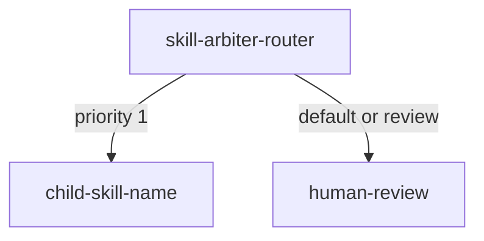

# {{Router 标题}}

> 模板版本：9.0.0。Router 只分离可判定任务边界，**不得用于绕过 S0 安全/正确性矛盾**。替换所有 `{{字段}}`。

## 1. 适用范围

- **输入可观察字段**：`{{任务标签/文件类型/显式请求/diff 行数等}}`
- **排除场景**：`{{不可判定或涉及未解决 S0 的场景}}`
- **全局检查依据**：`{{pair、三元/N 元与对抗复核引用}}`

## 2. 可判定决策表

| 优先级 | 输入条件 | 分发目标 | 排除场景 | 条件依据/证据字段 | 无法判定时行为 |
|---|---|---|---|---|---|
| 1 | `{{可观察、可复现条件}}` | `{{子技能名}}` | `{{不适用条件}}` | `{{输入字段与原文依据}}` | `{{安全回退或 human-review}}` |
| 99 | 默认：以上条件均不满足且不存在未解决 S0 | `{{默认子技能或 human-review}}` | `{{默认排除}}` | 默认分支覆盖检查 | 无法确定任务类型则停止分发并给修复路径 |

禁止使用“复杂任务”“需要时”“看情况”等不可判定条件。

## 3. 条件互斥与覆盖检查

| 检查 | 方法 | 结果 |
|---|---|---|
| 两两重叠 | `{{列出条件对及交集；有交集则验证固定优先级}}` | `{{pass/fail/human-review}}` |
| 默认覆盖 | `{{枚举不满足任何条件的输入}}` | `{{pass/fail}}` |
| 不可判定输入 | `{{缺字段、冲突标签、未知文件类型}}` | `{{停止/待人工及修复}}` |
| S0 回退安全 | `{{证明所有分支及默认均保留 S0}}` | `{{pass/fail}}` |

## 4. 默认回退与失败降级

- 默认行为：`{{目标或 human-review}}`。
- 不得默认到已知会违反 S0 的技能。
- 任务类型无法判定时，输出 `human-review` 或 `rejected`，列修复路径；不得随机选择。
- S0 未解决时不生成可用 Router；保留拒绝报告。

## 5. 子技能 frontmatter 约定

每个子技能使用独立目录 `<child-name>/SKILL.md`，至少包含：

```yaml
---
name: child-skill-name
description: Describe one observable task domain and explicit exclusions; keep within 1024 characters.
---
```

名称匹配 `^[a-z0-9]+(?:-[a-z0-9]+)*$` 且≤64。跨 Agent 公共字段仅依赖 `name` 与 `description`；扩展字段须按目标宿主文档核对。

## 6. 规则归属与触发词互斥

| 子技能 | 唯一归属规则 ID | 允许触发词/条件 | 明确排除的触发词/条件 |
|---|---|---|---|
| `{{child-a}}` | `{{ID 列表}}` | `{{集合}}` | `{{其他子技能集合}}` |

所有源规则必须且只能归属一个最终处置类别。路由不是删除，重叠规则须由固定优先级或改写条件消解。

## 7. 加载顺序图



```json
{
  "nodes": ["skill-arbiter-router", "child-skill-name", "human-review"],
  "edges": [
    {"from": "skill-arbiter-router", "to": "child-skill-name", "relation": "route", "condition": "priority 1", "directed": true},
    {"from": "skill-arbiter-router", "to": "human-review", "relation": "fallback", "condition": "default or review", "directed": true}
  ]
}
```

## 8. 验证方式

1. 用可观察字段的最小输入逐一命中每个分支。
2. 验证重叠输入只由固定优先级选择一个目标。
3. 验证默认输入、未知输入和缺字段输入。
4. 对每个分支检查所有 S0 规则仍同时成立。
5. 重跑三元/N 元检查、provenance 和 worked example 三检查。
6. 接管探针未真实运行时记录 `not-run`，不得写通过率。

## 摘要

```yaml
arbiter-summary:
  version: "9.0.0"
  mode: "full"
  skills_in: 0
  groups_out: 0
  verdict: "human-review"
  rules: {total: 0, kept: 0, deduped: 0, conditional: 0, deferred: 0, excluded: 0}
  conflicts: {exclusive: 0, shared: 0, entangled: 0, contradictory: 0, dependency: 0, intent: 0}
  severity: {S0: 0, S1: 0, S2: 0, S3: 0}
  degraded_level: "none"
  actionability: "router-generated"
  confidence: {certain: 0, high: 0, medium: 0, low: 0}
  open_questions: ["Router 模板尚未用真实输入验证"]
  appeal_path: "提供可判定边界或反例后重新检查；S0 不可由路由推翻"
```

<!-- FILE END: templates/router-skill.md -->
<!-- PROGRESS: 6/21 -->
