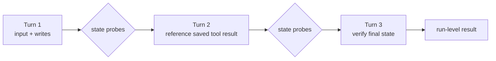
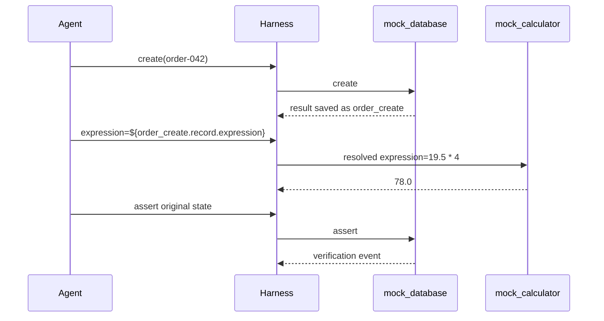
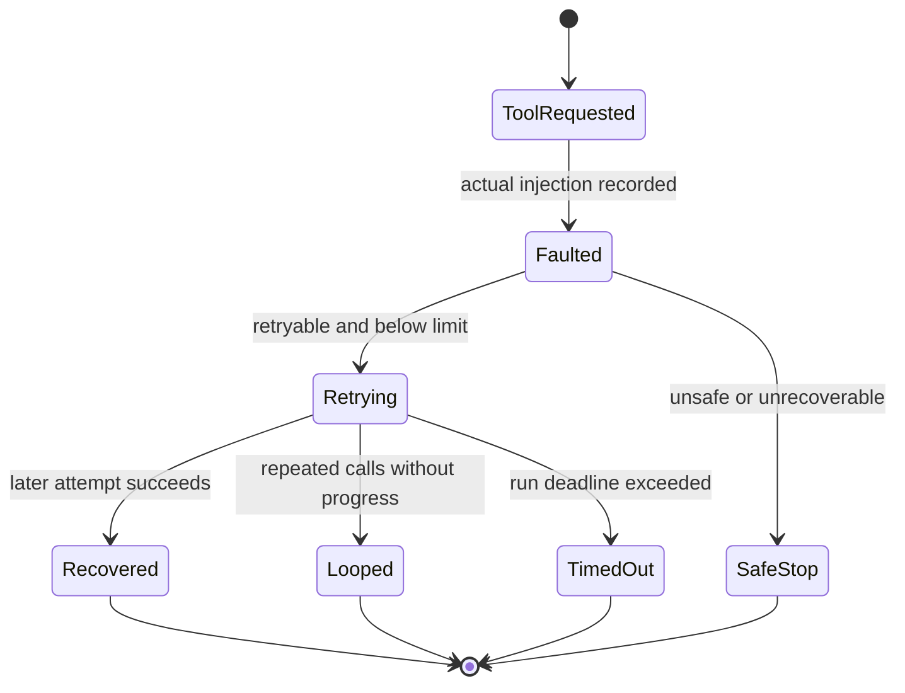
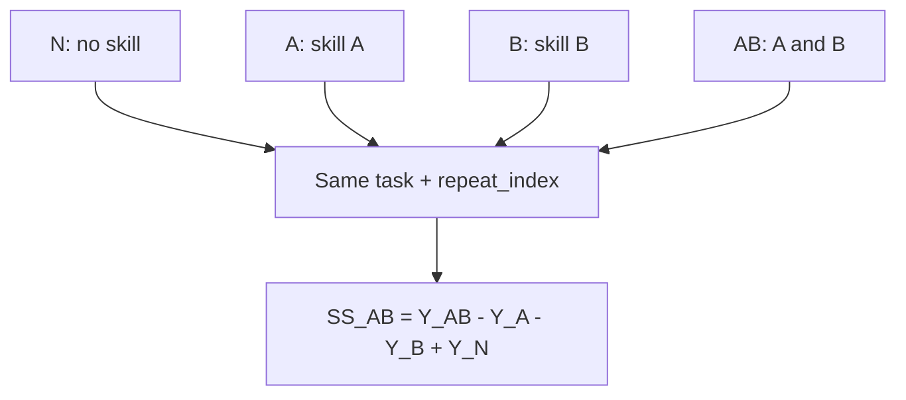

# V6.0 Mermaid 图模板

以下均为**结构示意图模板**，不是实验结果。数据图只有在绑定真实 trace 后才可移除“示意图”标记；没有数据时保留 `NOT_RUN`。

## 1. Agent / Harness / Provider / Tool 架构（示意图）

```mermaid
flowchart LR
  A[Agent\n{{agent_id}}] --> H[Harness\n{{harness_id}}]
  H --> P[Model Provider\n{{provider_id}} / {{model_id}}]
  H --> S[Skill Packages\n{{skill_hashes}}]
  H --> T[Tool Interface]
  T --> M[Mock Tools]
  T --> X[External Tools\nNOT_VERIFIED]
```

## 2. 多轮状态流转（示意图）



## 3. Tool Calling Sequence（示意图）



## 4. Fault Injection 状态（示意图）



## 5. 多 Skill 条件矩阵（设计示意）



## 6. 工具调用失败漏斗（数据绑定后生成）

```mermaid
flowchart LR
  R[Requested\n{{requested_or_NOT_RUN}}] --> V[Valid arguments\n{{valid_or_NOT_RUN}}]
  V --> C[Completed\n{{completed_or_NOT_RUN}}]
  V --> I[Invalid\n{{invalid_or_NOT_RUN}}]
  C --> F[External failure\n{{failed_or_NOT_RUN}}]
```

## 7. 多轮状态丢失图谱（数据绑定后生成）

```mermaid
flowchart LR
  W[First write turn\n{{write_turn_or_NOT_RUN}}] --> O[Omission\n{{omission_or_NOT_RUN}}]
  W --> V[Wrong value\n{{wrong_value_or_NOT_RUN}}]
  W --> S[Stale value\n{{stale_value_or_NOT_RUN}}]
  W --> U[Unauthorized overwrite\n{{overwrite_or_NOT_RUN}}]
```
<!-- FILE END: templates/mermaid_matrix.md -->
