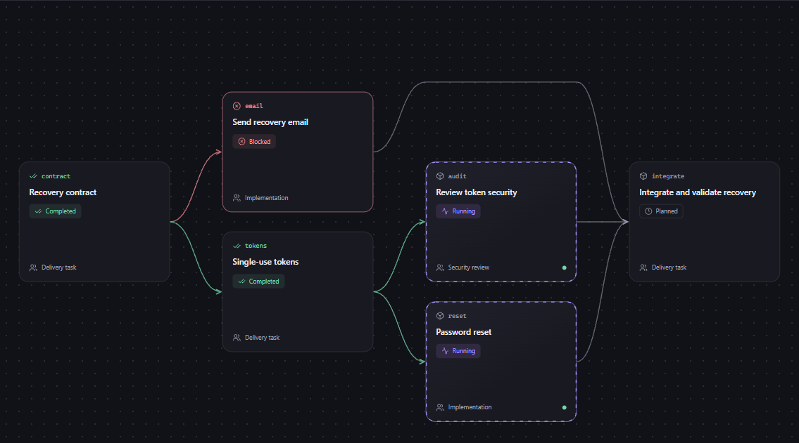
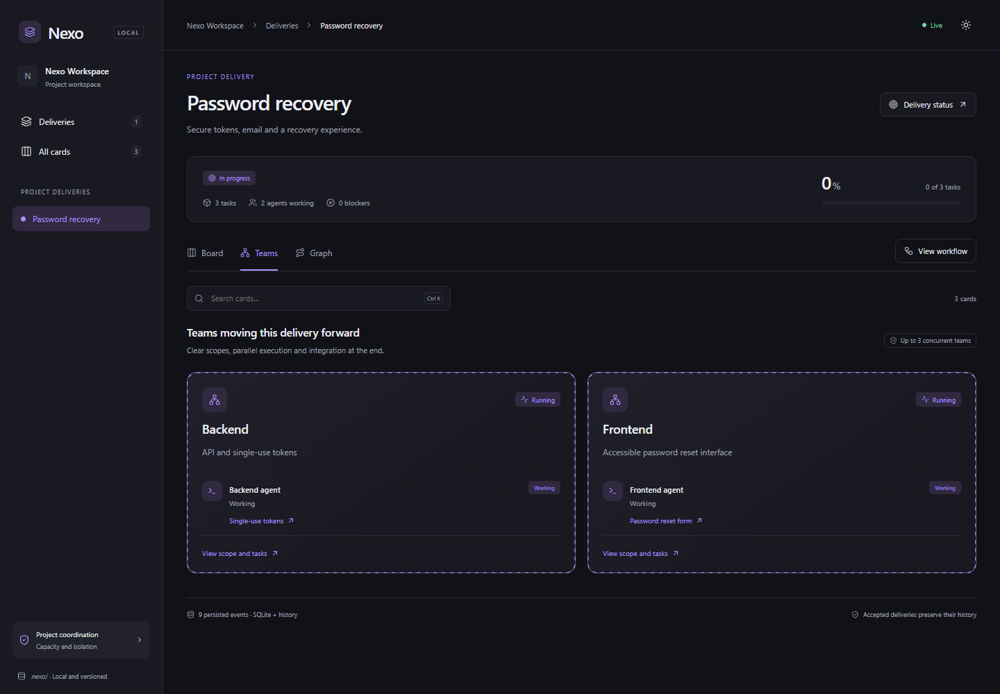

I wanted a way to see how parallel Claude Code work connects to the result I asked for. Separate agent conversations can explain individual tasks, but understanding who owns each task, what is blocked and what remains before delivery requires assembling the picture yourself.

[Nexo](https://github.com/heamaral/nexo-claude) is a free, MIT-licensed Claude Code plugin with a live local browser board. It organizes work as projects, deliveries, tasks and subtasks. Each delivery has its own teams and active agents. This is an early release candidate, and I am its creator.

## Hierarchy and dependencies answer different questions

A parent card describes what belongs together. A dependency describes what must finish before another task can proceed. Treating these as the same relationship produces confusing graphs.

Nexo keeps them separate. A hierarchy view shows composition; a dependency view shows branching and joining execution paths. Parent progress is based on leaf tasks, so a task and its parent are not counted twice. Columns and review stages can adapt to the project.



The screenshots use English fixture data. They illustrate the interface, not a production deployment or a performance benchmark.

## Ownership needs more than an agent name on a card

The plugin includes planner, worker and reviewer agents, MCP tools and lifecycle hooks. The planner maintains the plan. Workers claim tasks with explicit identities and scopes, renew expiring leases while working and release them when finished.

The local service checks ownership, fencing, expected entity versions and overlapping write scopes. These checks help reject stale completions and conflicting task updates. They do not sandbox arbitrary shell commands or prove that an implementation is correct. Parallel teams should still use separate worktrees.

Real Claude Code planner/worker sessions and separate worktrees were used in isolated integration trials. Implementation was AI-assisted, primarily with Codex; Claude Code sessions exercised the plugin through its actual MCP and hook integration.

## A snapshot failure should not stop agents

A Windows file-sharing failure made an architectural boundary especially useful. Replacing an exported SQLite snapshot can fail while another process holds the destination. That does not mean the live database or agent leases should become unavailable.

Nexo separates snapshot publication from live coordination. A single directory writer owns the live store. Snapshot publication coalesces pending work and retries temporary sharing failures asynchronously. Agent heartbeats do not reconstruct snapshots. A failed publication preserves the previous complete snapshot and reports its own health separately.

Durable project history is represented by immutable event files and closed SQLite snapshots that can be committed to Git. Live leases, tokens and logs stay in ignored local state. Binary snapshots cannot be semantically merged by Git; event history supports reconstruction and explicit conflict handling.



## Keep installation out of the user's way

The rc.6 release includes native launchers that prepare a pinned, verified private Node runtime. Users do not configure a Node path or change their global Node installation. First setup needs internet access; a verified cache works offline.

CI exercises Windows, macOS and glibc Linux on x64 and ARM64. Checks include native Claude startup with Node absent from PATH, offline runtime reuse and lease continuity after MCP reconnection. These are specific fixture checks; broader feature pilots, security/recovery review and scale validation remain open.

## Try it in a project

In Claude Code:

```text
/plugin marketplace add heamaral/nexo-claude
/plugin install nexo@nexo-marketplace
/nexo:init
/nexo:plan Implement password recovery with tests and review
/board
```

The authenticated browser view is read-only and updates live. It includes light/dark themes, task and workflow modals, and responsive layouts. Changes flow through MCP.

The [repository](https://github.com/heamaral/nexo-claude) includes installation instructions, architecture, security boundaries and validation evidence. I would appreciate feedback from developers running several Claude sessions or worktrees: does the delivery-to-task hierarchy help, and which coordination failure should the board represent next?
