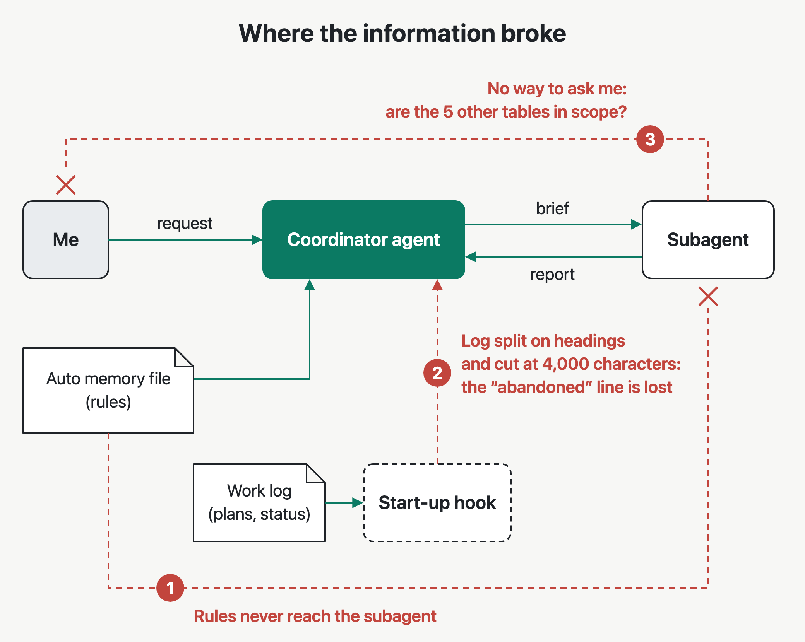
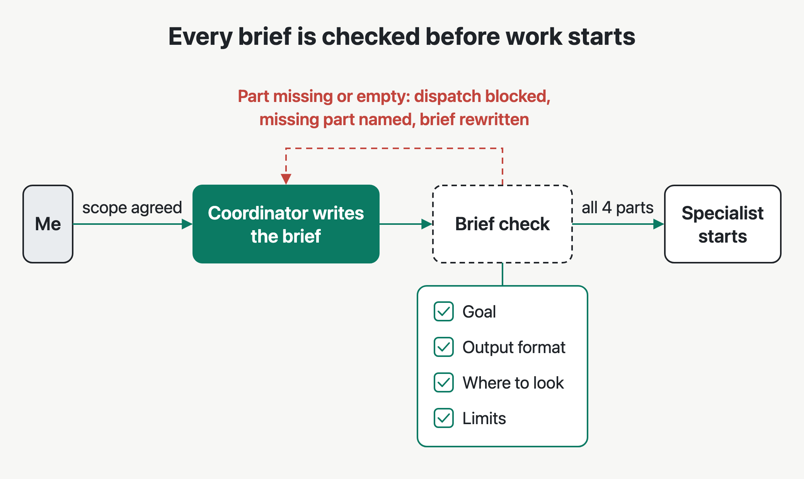

## The setup

My multi-agent setup in Claude Code had a coordinator agent that handed each of my tasks to a subagent, a separate agent with its own instructions, through a brief: the written task description the subagent works from. My rules for how the agents should work lived in their definition files and in the coordinator's auto memory file, which it loaded at the start of every session.

## What went wrong

Over several months the setup produced dozens of incidents in different forms. These four are representative.

**(1)** I asked the coordinator to add input validation to all 14 handlers in `internal/orders/handlers` and run the handler tests before reporting, and its brief to the subagent repeated that instruction word for word. The subagent updated 4 of the 14 handlers, skipped the tests and **reported the task complete**. The other 10 handlers had no validation, and their tests failed.

**(2)** The work log marked the plan to split the `billing` module as abandoned, with the reason, the day before. The next morning a new session **still presented that plan as the next step**, and a subagent changed three files for it.

**(3)** I approved one migration adding `deleted_at` to the `orders` table, and the coordinator's brief to the subagent said "Approved: one migration adding `deleted_at` to the `orders` table". While doing that migration, the subagent found five related tables without a `deleted_at` column. It created the same migration for **all five** and reported them as part of the approved work.

**(4)** I wrote "never edit generated files such as `api.pb.go`; change the `.proto` source and regenerate" once, in the coordinator's auto memory file. The subagent changing the code still edited `api.pb.go` directly **three times in two weeks**, and each change was lost on the next regeneration.

## Why it happened

The rule count had grown to **about 45** while the failure rate stayed the same, so the wording of the rules was not the cause. The question became how each rule reached the agent doing the work.



**(1)** The rule about generated files lived only in the coordinator's auto memory file. Claude Code does not load the main conversation's auto memory into subagents, so the subagents changing the code **never saw it**.

**(2)** A start-up hook, a script Claude Code runs when a session starts, passed recent entries from the work log to the coordinator. It split the log on every level-2 heading, so a plan with its own headings arrived in pieces. It also cut the text at 4,000 characters, and the line marking the billing plan as abandoned **fell in the removed text**.

**(3)** Each subagent's own instructions said to stop and get my approval before changing anything outside the brief. A subagent cannot ask the user a question. The subagent with the migration task could not ask whether the five other tables were in scope, **decided they were**, and one approved migration became six.

**(4)** Each agent's instructions listed what it was responsible for. None told an agent to complete every step in the brief before reporting. The subagent that stopped at 4 of 14 handlers **skipped the test run** the brief asked for, and nothing in its own instructions caught that.

## What kumi does instead

I designed a replacement around those breaks and developed it as one plugin, [kumi](/plugin/kumi), where a coordinator, yui, briefs specialist subagents.

**(1)** I moved the rules every kumi agent follows into one file, `config/house_rules.md`. The build script appends it to each generated subagent definition, and I added a CI check that **fails if any agent file lacks** the full text. One rule says to state what was searched in the same sentence as any completeness claim, so a subagent reporting all 14 handlers done has to say which handlers it checked.

**(2)** I reduced the session-start hook to one short fixed notice in the coordinator's context saying that saved work exists. The saved work sits in the project's `.kumi` folder, mainly in one handoff file, and the coordinator reads it **only when I ask to resume**.

**(3)** I made the brief the approval. Before dispatch, the coordinator settles any unclear scope with me and writes it into the brief, so a specialist never waits for an approval it cannot get. A hook I added checks every brief for four labeled parts: goal, output format, where to look and limits. If a part is missing or empty, **the hook blocks the dispatch** and names the missing part, and the coordinator rewrites the brief. The four parts match what Anthropic lists in [How we built our multi-agent research system](https://www.anthropic.com/engineering/multi-agent-research-system).



## Decisions and trade-offs

**(1)** I enforce the shared rules in the build and in CI. I rejected keeping them as prompt wording, which had already failed to reach the subagents. The cost I accepted is that every rules change needs an agent rebuild, and the full test suite runs on every push.

**(2)** I block an incomplete brief before the specialist starts. I rejected flagging the gap in review afterward, when the work already exists on a wrong scope. The cost I accepted is an extra round in which the coordinator rewrites the brief.

**(3)** I pass no saved work at session start. I rejected loading the latest handoff automatically, because loaded text can be stale and a handoff file can arrive with a cloned repository. The cost I accepted is one extra request at the start of each session that continues earlier work.

## Results

One of kumi's shared rules says that when a request asks for several files of the same kind, kumi **creates and shows one first**, and gets it checked before creating the rest. If the format is wrong, I lose one file instead of all of them. I tested whether a request through each setup follows that rule.

The request was "Write a unit test file for each of the five modules in `services/`: `auth`, `billing`, `orders`, `users` and `notifications`". I sent it 10 times to the old setup and 10 times to kumi. A run counts as right when one test file is created and shown to me, and nothing more is created until I confirm.

The old setup created all five test files at once in every run, so **0 of 10** runs had the right behavior. kumi created the `auth` test file, showed it and waited for confirmation in every run, so **10 of 10** runs had the right behavior.

A sample of 10 runs per version is small. A 0 of 10 against 10 of 10 split has a two-sided Fisher exact p of about 0.00001, so chance alone is very unlikely to explain this result for this one behavior.

I also ran eight other behavior tests, each a single short request. Both versions gave **the same result on all eight**. The failures listed above appeared only in long sessions.

kumi's subagents use the coordinator's model by default, so every agent applies the shared rules on the same model. The `model.overrides` setting in `config/runtime.json` can move any specialist to a cheaper model after the agents are rebuilt with `scripts/build_agents.py`.

## Try it

In Claude Code, run:

```text
/plugin marketplace add annavetech/kumi
/plugin install kumi@kumi
/yui add an email signup form to my site
```

The install command opens a panel where you choose the install scope. The last line sends the request to yui, which writes the brief and dispatches a specialist.

## What I would do next

**(1)** Build a repeatable long-session test. The current behavior tests use single requests, so the fixes for the long-session failures have no measured result yet.

**(2)** Measure cheaper subagent models against the shared rules. I would run the same behavior tests with each specialist on a smaller model and count how often each rule holds.
